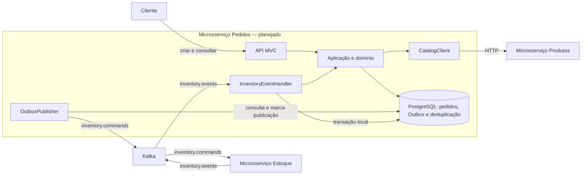
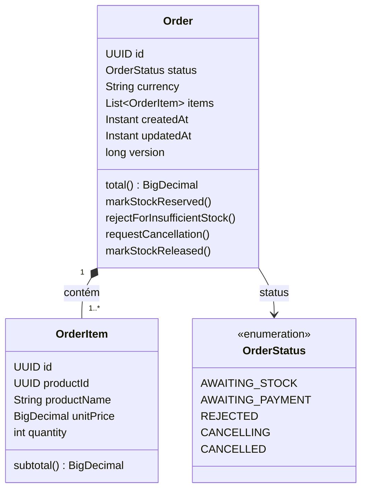
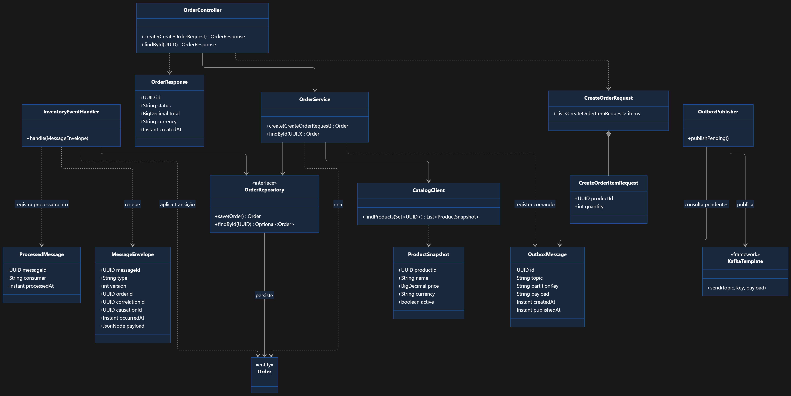
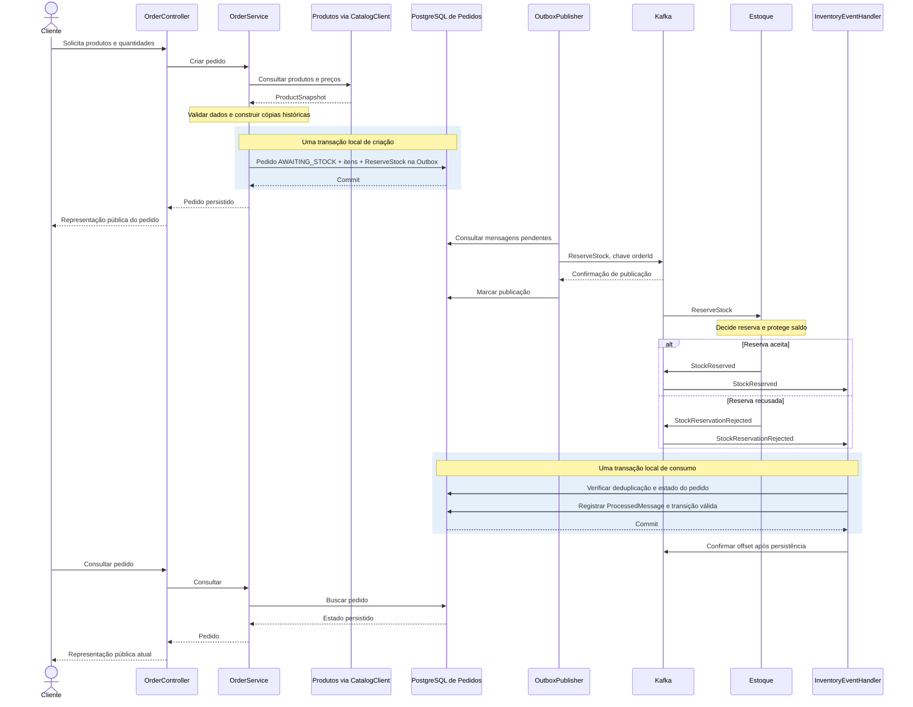

# Arquitetura do microsserviço de Pedidos

Estado: **proposta para revisão**, em 27/10/2026. Este documento registra a arquitetura solicitada e a leitura do repositório; não constitui aprovação de comportamento nem evidência de execução.

## 1. Objetivo e escopo

Descrever o estado real de Pedidos e a proposta para criação de pedidos, consulta ao catálogo, reserva de estoque e recebimento do resultado dessa reserva. `AWAITING_PAYMENT` é o limite do primeiro fluxo: não indica pagamento implementado.

A legenda de estado usada neste documento é:

- **Verificado por leitura**: arquivo, declaração ou código encontrado no repositório. Não significa compilação ou funcionamento verificado em execução.
- **Planejado**: componente ou contrato solicitado, ainda ausente do código.
- **Proposta pendente de aprovação**: decisão de desenho ou comportamento que deverá ser detalhada em uma especificação de funcionalidade e aprovada pelo fluxo SDD antes de implementar.

Todos os diagramas e comportamentos de negócio abaixo são planejados ou propostas pendentes de aprovação. O inventário da seção 2 identifica a implementação existente. Esta visão não substitui `specs/<funcionalidade-kebab-case>/spec.md` e `tasks.md`, nem cria uma especificação global.

## 2. Estado atual, com evidências do repositório

| Evidência | Verificado por leitura | Limite da evidência |
| --- | --- | --- |
| [OrdersServiceApplication.java](src/main/java/com/dias/orders_service/OrdersServiceApplication.java) | Bootstrap com `@SpringBootApplication` e `SpringApplication.run` | Não contém fluxo de pedidos |
| [application.yaml](src/main/resources/application.yaml) | Nome da aplicação, configuração JPA e conexão padrão do datasource | Sem configuração explícita de Kafka ou integrações HTTP nesse arquivo |
| [pom.xml](pom.xml) | Dependências, Java e plugins descritos na seção 4 | Não foi resolvido ou compilado nesta tarefa |
| [OrdersServiceApplicationTests.java](src/test/java/com/dias/orders_service/OrdersServiceApplicationTests.java) | Um `contextLoads()` com `@SpringBootTest` e importação de Testcontainers | Teste presente, não executado |
| [TestcontainersConfiguration.java](src/test/java/com/dias/orders_service/TestcontainersConfiguration.java) | Beans com `@ServiceConnection` para Kafka e PostgreSQL | Containers não iniciados nesta tarefa |
| [TestOrdersServiceApplication.java](src/test/java/com/dias/orders_service/TestOrdersServiceApplication.java) | Entrada de desenvolvimento com configuração Testcontainers | Não executada |
| [mvnw](mvnw), [mvnw.cmd](mvnw.cmd) e [maven-wrapper.properties](.mvn/wrapper/maven-wrapper.properties) | Wrapper presente e distribuição Maven declarada | Download e execução não verificados |
| [Diagrama de classes existente](docs/diagrams/mermaid-diagram.png) | Proposta visual de API, aplicação e mensageria | Classes representadas ainda não implementadas |
| [HELP.md](HELP.md) | Guia gerado com referências da stack e imagens de containers | Não substitui especificação ou comprovação de funcionamento |

O inventário de `src` contém somente esses arquivos de bootstrap, configuração e teste. Não foram encontradas classes de domínio, controllers de pedidos, DTOs, repositórios de pedidos, clientes de catálogo, handlers de eventos, Outbox, deduplicação ou migrations Flyway.

`README.md`, `docs/project-status.md` e a pasta `specs/` não existiam na análise inicial. O status foi criado nesta tarefa. Não há especificação ativa encontrada. A raiz inspecionada não contém `.git`; a tentativa de consultar `git status` não encontrou um repositório Git. As evidências desta documentação são leitura e inventário de arquivos, sem validação por diff Git.

## 3. Contexto dos três microsserviços e responsabilidades de Pedidos

O contexto informado prevê **exatamente três microsserviços**:

| Microsserviço | Responsabilidade planejada |
| --- | --- |
| Produtos | Catálogo, preços e referências de imagens |
| Estoque | Quantidades, reservas, liberações e baixas; proteção contra venda acima do saldo |
| Pedidos | Ciclo da compra e coordenação do fluxo entre catálogo e estoque |

Este repositório contém apenas Pedidos. Produtos e Estoque são participantes externos da proposta, sem código local para confirmar seus contratos. Stripe e notificações serão funcionalidades internas futuras de Pedidos, sem criar outros microsserviços.

Pedidos deverá obter preços no backend pelo catálogo, preservar nome e preço como cópia histórica, persistir o pedido e coordenar comandos e resultados de estoque. A decisão sobre disponibilidade e a concorrência entre compradores pelo mesmo produto pertencem a Estoque.

## 4. Stack efetivamente configurada

| Tecnologia | Declaração encontrada | Situação |
| --- | --- | --- |
| Java | `java.version=25` em `pom.xml` | Configurado; JDK local e compilação não verificados |
| Spring Boot | Parent `spring-boot-starter-parent:4.1.2` | Versão declarada no POM; resolução não verificada |
| Maven Wrapper | Wrapper `3.3.4`, `distributionType=only-script`, distribuição Maven `3.10.0` | Arquivos presentes; execução não verificada |
| Spring MVC e Validation | `spring-boot-starter-webmvc` e `spring-boot-starter-validation` | Dependências declaradas; API de pedidos ausente |
| Spring Data JPA | Não há `spring-boot-starter-data-jpa` no POM | Pretendido, ainda não configurado; divergência para o modelo JPA proposto |
| PostgreSQL e Flyway | Driver PostgreSQL em runtime, `spring-boot-starter-flyway` e `flyway-database-postgresql` | Declarados; sem migrations; conexão configurada em `application.yaml` e no perfil `local` |
| Spring for Apache Kafka | `spring-boot-starter-kafka` | Declarado; contratos e processamento de pedidos ausentes |
| Actuator | `spring-boot-starter-actuator` | Declarado; endpoints efetivamente disponíveis não verificados |
| Testcontainers | Suporte Spring Boot, JUnit Jupiter, Kafka e PostgreSQL em escopo test | Configuração de containers presente; não executada |
| Lombok | Dependência opcional e processador de anotações no compiler plugin | Declarado; não utilizado no bootstrap existente |

O POM também declara starters de teste para Actuator, Flyway, Kafka, Validation e Web MVC, além do plugin Spring Boot. Os containers de teste usam `apache/kafka-native:latest` e `postgres:latest`. A adequação dessas tags e sua reprodutibilidade deverão ser avaliadas na funcionalidade de infraestrutura/testes; não foram alteradas.

Dependência declarada não comprova instalação, disponibilidade de serviços ou compatibilidade em execução. Esta tarefa não modifica dependências, wrapper ou configurações.

## 5. Diagrama Mermaid da arquitetura

Visão proposta dos três serviços e dos componentes internos de Pedidos; nenhum fluxo de negócio representado está implementado neste repositório.



PostgreSQL e Kafka são infraestrutura, não microsserviços adicionais. Os nomes dentro do banco indicam responsabilidades de persistência propostas, sem definir tabelas físicas. Pagamento e notificações não integram o fluxo desenhado.

## 6. Diagrama Mermaid das classes de domínio

Modelo proposto, ainda sem classes, mapeamento JPA ou migrations no código:



Regras solicitadas para futura especificação e aprovação:

- O pedido contém um ou mais itens, que pertencem ao pedido.
- `quantity` deve ser positiva e `unitPrice` não negativo.
- Cada pedido usa uma única moeda; a política para produtos com moedas diferentes ainda precisa ser definida.
- `subtotal()` calcula preço unitário × quantidade; `total()` soma os subtotais. Escala e arredondamento monetário permanecem pendentes.
- O cliente informa produtos e quantidades; os preços são obtidos pelo backend no catálogo, sem aceitar preço definido pelo cliente.
- Nome e preço de cada produto são preservados no pedido como cópia histórica.
- O domínio valida transições de estado; deduplicação não substitui essa validação.
- `version` destina-se à concorrência otimista. Seu mapeamento e a política de conflitos ainda dependem de especificação.

Os métodos de cancelamento fazem parte do modelo solicitado; seus estados de origem, condições e comandos associados ainda não foram definidos. A presença dos métodos não aprova essas regras.

## 7. Classes de API, aplicação e mensageria

O [diagrama de classes existente](docs/diagrams/mermaid-diagram.png) já representa este recorte:



Para atender à orientação final de reutilizar os diagramas de `docs/diagrams` sem duplicá-los, esta seção referencia o PNG em vez de redesenhar suas relações em outro bloco Mermaid. O arquivo foi inspecionado visualmente e permanece inalterado. Os diagramas Mermaid das demais seções acrescentam recortes complementares.

Leitura orientada do diagrama, sempre como proposta:

| Classe | Responsabilidade ou dados planejados |
| --- | --- |
| `OrderController` | Criar e consultar pedidos; receber request e devolver response |
| `CreateOrderRequest` | Lista de `CreateOrderItemRequest` |
| `CreateOrderItemRequest` | `UUID productId`, `int quantity` |
| `OrderResponse` | Representação pública, sem expor entidade JPA; o PNG sugere `id`, `status`, `total`, `currency`, `createdAt`, sem fechar o contrato público |
| `OrderService` | Coordenar criação, consulta, catálogo, persistência e registro do comando na Outbox |
| `CatalogClient` | Consulta HTTP de produtos; pode ser classe concreta com cliente HTTP Spring |
| `ProductSnapshot` | `UUID productId`, `String name`, `BigDecimal price`, `String currency`, `boolean active` |
| `OrderRepository` | Persistência de `Order`; poderá estender `JpaRepository` após aprovação e configuração JPA |
| `MessageEnvelope` | Envelope comum de comandos e eventos, detalhado abaixo |
| `OutboxMessage` | Registro de publicação pendente ou confirmada |
| `ProcessedMessage` | Deduplicação por consumidor e identificador da mensagem |
| `OutboxPublisher` | Consultar pendentes, publicar com `KafkaTemplate`, marcar após confirmação do Kafka |
| `InventoryEventHandler` | Receber eventos, verificar duplicidade, aplicar transição válida e persistir antes de confirmar offset |

DTOs podem ser records. Não há necessidade demonstrada de adicionar camadas ou interfaces além dessas responsabilidades. As assinaturas ilustradas no PNG não definem endpoints ou contratos HTTP aprovados.

O envelope solicitado contém todos os campos abaixo; obrigatoriedade, nulabilidade e regras de evolução ainda dependem da especificação dos contratos:

| Campo de `MessageEnvelope` | Tipo proposto |
| --- | --- |
| `messageId` | `UUID` |
| `type` | `String` |
| `version` | `int` |
| `orderId` | `UUID` |
| `correlationId` | `UUID` |
| `causationId` | `UUID` |
| `occurredAt` | `Instant` |
| `payload` | JSON; o diagrama existente sugere `JsonNode` |

`OutboxMessage` contém `UUID id`, `String topic`, `String partitionKey`, `String payload`, `Instant createdAt` e `Instant publishedAt`. `ProcessedMessage` contém `UUID messageId`, `String consumer` e `Instant processedAt`, com restrição única por `(consumer, messageId)`. Não há mapeamento físico definido para esses registros.

## 8. Sequência da criação até o resultado da reserva

Sequência proposta para processamento válido. Não define rota, status HTTP, payload completo, tempo limite ou política de repetição. A consulta HTTP ao catálogo antecede a transação local de criação; esse posicionamento é uma proposta para aprovação.



O recebimento da resposta de criação não implica que a reserva já terminou. Uma falha na persistência não deve levar à confirmação do offset. O tratamento concreto de duplicatas, mensagens inválidas, pedidos inexistentes e falhas HTTP deve ser especificado antes da implementação.

## 9. Estados e transições do primeiro fluxo

O modelo solicitado limita o enum a cinco estados. O diagrama mostra apenas as transições de reserva propostas; os estados de cancelamento aparecem sem transições porque sua política está pendente.

```mermaid
stateDiagram-v2
    [*] --> AWAITING_STOCK: criação persistida
    AWAITING_STOCK --> AWAITING_PAYMENT: StockReserved / markStockReserved()
    AWAITING_STOCK --> REJECTED: StockReservationRejected / rejectForInsufficientStock()
    state CANCELLING
    state CANCELLED
    note right of AWAITING_PAYMENT
        Limite do primeiro fluxo
        Pagamento ainda futuro
    end note
    note right of CANCELLING
        Origens, comandos e corridas pendentes
    end note
    note right of CANCELLED
        Condições para conclusão pendentes
    end note
```

| Situação | Tratamento no desenho proposto |
| --- | --- |
| Criação válida | Persistir em `AWAITING_STOCK`, junto com `ReserveStock` na Outbox |
| `StockReserved` enquanto `AWAITING_STOCK` | Evoluir para `AWAITING_PAYMENT` |
| `StockReservationRejected` enquanto `AWAITING_STOCK` | Evoluir para `REJECTED` |
| Mensagem repetida com mesmo `messageId` e `consumer` | Deduplicar sem repetir o efeito de negócio |
| Mensagem distinta incompatível com o estado atual | Validar estado; política operacional ainda pendente |
| Solicitação de cancelamento | Definir estados permitidos, efeitos de `requestCancellation()` e eventual `ReleaseStock` |
| `StockReleased` | Definir condições de `markStockReleased()` e conclusão em `CANCELLED` |
| `StockReserved` concorrente ou atrasado durante cancelamento | Definir compensação e transição; não presumir conclusão ou descarte automático |

Uma possibilidade a avaliar é usar `CANCELLING` enquanto aguarda a liberação e só concluir em `CANCELLED` após o resultado correspondente. Isso é uma **proposta adicional pendente**, não uma transição aprovada. É necessário definir também cancelamento antes da reserva, após reserva e após rejeição. Eventos de confirmação definitiva não ampliam este primeiro fluxo implicitamente.

## 10. Integrações HTTP e contratos Kafka planejados

### HTTP

`OrderController` deverá permitir criação e consulta; `CatalogClient` deverá consultar Produtos e obter `ProductSnapshot`. Não foram encontrados endpoints de pedidos nem contratos HTTP de Produtos. Rotas, métodos, status, formato de erros, autenticação, timeouts e repetição permanecem pendentes. O campo `active` está previsto no snapshot, mas a regra para produto inativo deve ser especificada, sem presumir comportamento.

### Kafka

| Tópico planejado | Produtor → consumidor | Tipos de mensagem | Escopo |
| --- | --- | --- | --- |
| `inventory.commands` | Pedidos → Estoque | `ReserveStock` | Reserva do primeiro fluxo proposto |
| `inventory.commands` | Pedidos → Estoque | `ReleaseStock` | Liberação; condições de cancelamento pendentes |
| `inventory.commands` | Pedidos → Estoque | `CommitStock` | Evolução futura de confirmação definitiva ligada ao pagamento |
| `inventory.events` | Estoque → Pedidos | `StockReserved`, `StockReservationRejected` | Resultado da reserva |
| `inventory.events` | Estoque → Pedidos | `StockReleased` | Resultado de liberação; transições pendentes |
| `inventory.events` | Estoque → Pedidos | `StockCommitted`, `StockCommitRejected` | Evolução futura de confirmação definitiva ligada ao pagamento |

A chave de particionamento planejada é `orderId` em ambos os tópicos. A ordenação é restrita à partição; não há garantia global nem entre tópicos. Essa chave não resolve concorrência entre pedidos diferentes que disputam o mesmo produto. A proteção contra venda acima do saldo deve ser implementada em Estoque.

Os nomes de tópicos e tipos são contratos planejados, sem evidência de tópicos provisionados. Payloads, versionamento compatível, semântica de identificadores, retenção, partições e política de falhas ainda precisam ser acordados com Estoque. Não se presume entrega exatamente uma vez de ponta a ponta.

## 11. Persistência, Outbox, deduplicação e limites transacionais

Desenho proposto para PostgreSQL, ainda sem JPA, esquema ou migrations implementados:

1. **Criação:** pedido, itens e comando `ReserveStock` na Outbox são persistidos na mesma transação local. Um rollback deve impedir a persistência parcial desses registros.
2. **Consumo:** registro de deduplicação e alteração do pedido são persistidos na mesma transação local. Caso o processamento gere novo comando, sua Outbox integra essa mesma transação. O offset só pode ser confirmado após o processamento persistido.
3. **Publicação:** `OutboxPublisher` consulta pendentes, publica com `KafkaTemplate` e marca publicação após confirmação do Kafka. Não se presume transação única entre PostgreSQL e Kafka.
4. **Republicação:** falha após publicar e antes de marcar a Outbox pode republicar a mensagem. Consumidores precisam tratar duplicatas; a regra de manutenção do `messageId` em republicações deve ser formalizada no contrato.
5. **Validação de estado:** mensagens com identificadores diferentes podem representar ações atrasadas ou incompatíveis. A unicidade de `(consumer, messageId)` não substitui as regras do domínio.

`long version` deverá apoiar concorrência otimista do pedido. A restrição única de deduplicação deverá proteger contra processamento concorrente do mesmo identificador para o mesmo consumidor. A política para conflitos, rollback e nova tentativa permanece pendente.

As especificações de funcionalidade deverão definir mapeamento JPA, migrations, polling, seleção e concorrência de publicadores, identificação de pendências, política de limpeza/retenção, tratamento de falhas e confirmação de offsets. Nenhum nome de tabela, intervalo de polling ou configuração de execução é estabelecido aqui.

## 12. Estratégia de validação e testes

### Evidência real desta tarefa

Foram lidos instruções SDD e configurações de agentes, pedido fornecido, POM, fontes, recursos, testes, arquivos do wrapper e `HELP.md`. Foi inventariada a ausência inicial de README, status e especificações; o PNG existente foi inspecionado visualmente. A revisão se limita a conteúdo e consistência documental.

Foram conferidos os 28 links locais dos dois documentos, todos com destinos existentes, as 14 seções numeradas desta arquitetura e os delimitadores dos quatro blocos Mermaid. Os diagramas Mermaid não foram renderizados.

**Não foram executados build, testes, aplicação, containers, banco ou Kafka. Cobertura não foi medida.** O único teste encontrado, `contextLoads()`, não demonstra cobertura do fluxo de negócio e não teve resultado verificado nesta tarefa.

### Estratégia proposta para futuras funcionalidades

| Área | Validações a detalhar nos critérios de aceitação da funcionalidade |
| --- | --- |
| Domínio | Um ou mais itens, quantidade positiva, preço não negativo, moeda única, totais, cópia histórica e transições válidas/inválidas |
| API e catálogo | Validação de requests, preços obtidos no backend, resposta sem entidade JPA; produto ausente/inativo, falhas HTTP e erros conforme contrato aprovado |
| Persistência | Atomicidade de pedido/itens/Outbox, rollback, migrations, concorrência otimista e unicidade de deduplicação |
| Kafka e Outbox | Publicação confirmada, falha entre envio e marcação, republicação, duplicatas, mensagens incompatíveis/atrasadas e offset posterior ao commit |
| Integração | PostgreSQL e Kafka com Testcontainers para cenários reais de persistência e mensageria, após infraestrutura e contratos definidos |
| Fluxo | Criação até reserva aceita/recusada; cancelamento e corridas somente após aprovação das respectivas regras |

Cada teste futuro deverá se vincular aos critérios de aceitação de `specs/<funcionalidade>/spec.md` e às tarefas da mesma funcionalidade. A orientação do [agente engenheiro](.codex/agents/software-engineer.toml) busca pelo menos 90% de cobertura unitária por unidade implementada; esse objetivo não é uma métrica obtida. A medição e a ferramenta precisarão ser definidas, sem acrescentá-las nesta tarefa documental.

## 13. Decisões pendentes, limitações e funcionalidades futuras

| Tema | Lacuna ou decisão para revisão |
| --- | --- |
| Aprovação SDD | Não existem especificações aprovadas encontradas; aprovar esta visão não dispensa especificar e aprovar cada funcionalidade |
| Stack JPA | Stack pretendida e desenho de repositório JPA divergem do POM atual, que não declara Spring Data JPA |
| Diagrama existente | Representa classes ainda ausentes; deve ser lido como proposta. Seção 7 reutiliza o PNG em vez de duplicar suas relações em Mermaid |
| Domínio | Definir escala/arredondamento, múltiplas moedas na entrada, produtos repetidos e política para produto inativo/ausente |
| API e catálogo | Fechar contratos públicos, tratamento de erros, falhas e política de repetição, sem inventar endpoints |
| Cancelamento | Definir origens permitidas, comandos, liberação, resultado esperado e corrida com reserva; não há transições aprovadas |
| Contratos de mensagens | Definir payloads, versões, identificadores, nulabilidade e evolução em conjunto com Estoque |
| Falhas e concorrência | Definir mensagens incompatíveis, pedido inexistente, conflitos otimistas, novas tentativas e falhas permanentes |
| Operação | Definir polling, concorrência de publicadores, offsets, retenção, configurações e observabilidade |
| Validação | Build, resolução de dependências, testes e cobertura ainda não verificados; tags `latest` dos containers merecem decisão de reprodutibilidade |

Não foram encontradas especificações com as quais registrar conflito de comportamento. A diferença entre as classes do PNG e o bootstrap atual é uma lacuna de implementação, não evidência de funcionalidade existente. O pedido solicita um diagrama Mermaid para esse recorte e, ao final, solicita evitar duplicar diagramas existentes: a escolha de referência ao PNG está explícita na seção 7 para revisão.

Stripe, processamento de pagamentos, notificações e confirmação definitiva de estoque são futuros. `CommitStock`, `StockCommitted` e `StockCommitRejected` deverão ser especificados junto à evolução do pagamento. Não há estados adicionais de pagamento aprovados e não são introduzidos neste documento.

## 14. Referências às especificações existentes

Nenhuma pasta `specs/`, `spec.md` ou `tasks.md` de funcionalidade foi encontrada na análise inicial; portanto não há especificação ativa ou critérios aprovados para referenciar.

As regras do processo estão em [AGENTS.md](AGENTS.md), [.codex/config.toml](.codex/config.toml) e nas configurações dos agentes [arquiteto](.codex/agents/spec-architect.toml), [engenheiro](.codex/agents/software-engineer.toml), [revisor](.codex/agents/code-reviewer.toml) e [redator de MR](.codex/agents/mr-writer.toml). O desenho visual de referência está em [docs/diagrams/mermaid-diagram.png](docs/diagrams/mermaid-diagram.png).

Próxima ação: revisar as decisões pendentes desta visão e definir o recorte da primeira funcionalidade. Depois, elaborar seus próprios `specs/<funcionalidade-kebab-case>/spec.md` e `tasks.md`, com critérios verificáveis, e obter aprovação explícita antes de delegar implementação. O acompanhamento desta entrega está em [project-status.md](docs/project-status.md).
