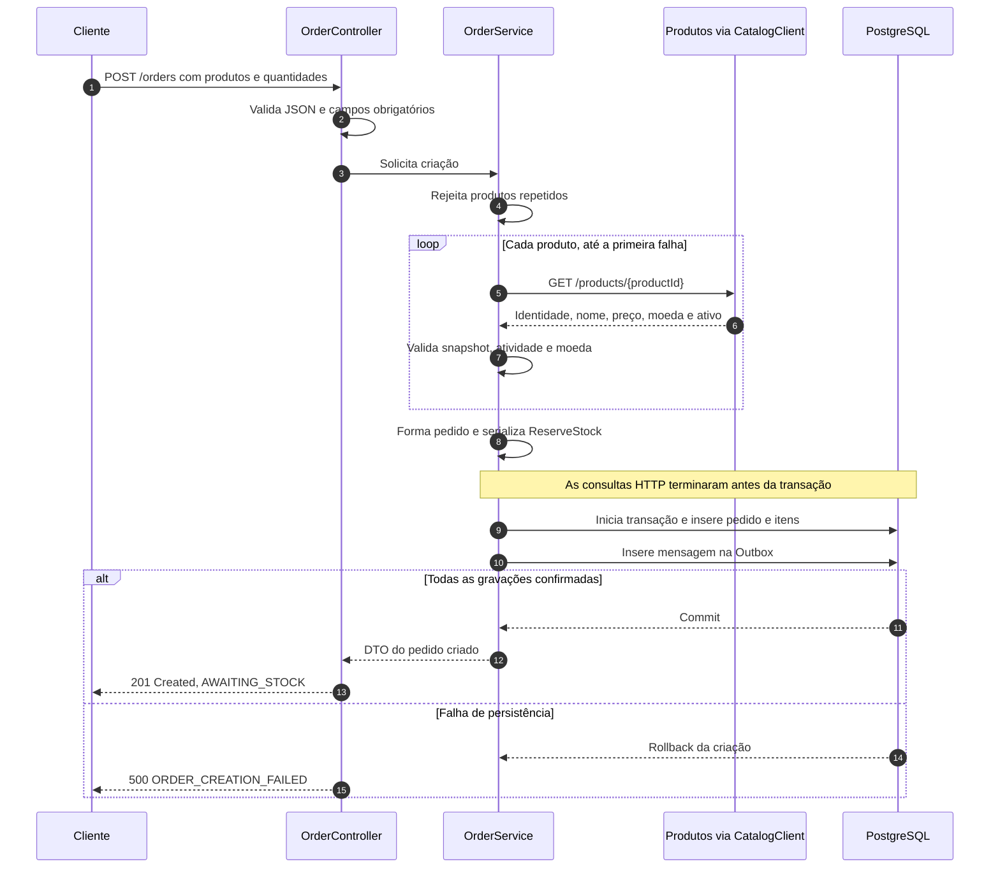
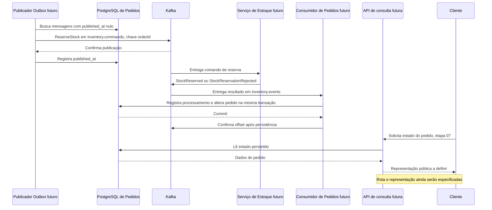

# Fluxo da aplicação de Pedidos

Referência do estado implementado até a etapa 04, em 28/10/2026. Este documento explica o funcionamento; as especificações de cada funcionalidade continuam sendo a fonte dos comportamentos aprovados.

## Visão geral

O serviço recebe produtos e quantidades, consulta seus dados no catálogo e cria um pedido. Na mesma transação do banco, registra uma mensagem solicitando a reserva de estoque. A resposta de criação confirma que esses dados foram gravados.

A reserva será executada de forma assíncrona: nas etapas seguintes, um publicador enviará a mensagem ao Kafka, Estoque responderá e Pedidos atualizará o estado. Assim, a requisição HTTP de criação não precisará esperar pela reserva.

| Parte do fluxo | Situação atual |
| --- | --- |
| PostgreSQL, Flyway, JPA e suporte de testes | Implementados na etapa 01 |
| Pedido, itens, cálculos e transições de reserva | Implementados na etapa 02 |
| Tabelas de pedidos, itens, Outbox e mensagens processadas | Implementadas na etapa 03 |
| API de criação, consulta HTTP ao catálogo e gravação atômica | Implementadas na etapa 04 |
| Publicação da Outbox no Kafka | Planejada na etapa 05 |
| Consumo do resultado da reserva | Planejado na etapa 06 |
| Consulta pública do pedido | Planejada na etapa 07 |
| Cancelamento, pagamento e notificações | Evoluções das etapas 08–10 |

Produtos e Estoque são serviços externos ainda indisponíveis, assim como a infraestrutura Kafka do projeto. O cliente HTTP de catálogo está implementado em Pedidos e foi validado com um servidor simulado. Os contratos foram definidos localmente; a integração com os serviços reais permanece pendente.

## 1. Inicialização

A aplicação precisa de uma conexão PostgreSQL e de `catalog.base-url`, que também pode ser definida por `CATALOG_BASE_URL`. A URL do catálogo é obrigatória; não existe catálogo de produção em memória ou endereço padrão presumido.

Na inicialização, Flyway aplica as migrations pendentes:

- V1 cria `orders` e `order_items`.
- V2 cria `outbox_messages` e `processed_messages`.

Hibernate valida o esquema com `ddl-auto=validate`. Open Session in View está desativado; o controller devolve um DTO, sem depender de navegação por entidades lazy para serializar a resposta. Kafka não é necessário para executar o fluxo de criação implementado.

Configuração do banco em [persistence.md](persistence.md) e do catálogo em [order-creation.md](order-creation.md).

## 2. Criação do pedido: fluxo implementado



### Entrada e validação

O cliente envia somente identificadores de produtos e quantidades:

```http
POST /orders
Content-Type: application/json
```

```json
{
  "items": [
    { "productId": "11111111-1111-4111-8111-111111111111", "quantity": 2 },
    { "productId": "22222222-2222-4222-8222-222222222222", "quantity": 3 }
  ]
}
```

A lista precisa conter ao menos um item. Cada produto aparece uma única vez e a quantidade deve ser um inteiro positivo no intervalo de `Integer`. Campos desconhecidos, como preço informado pelo cliente, também são rejeitados. Essas verificações acontecem antes das consultas ao catálogo e das gravações.

### Consulta ao catálogo

`CatalogClient` consulta cada produto sequencialmente em `GET /products/{productId}`. O contrato espera `productId`, `name`, `price`, `currency` e `active`.

O serviço verifica se a identidade corresponde à solicitada, se os dados são válidos e se o produto está ativo. Todos os produtos devem usar a mesma moeda ISO 4217 reconhecida pelo domínio. Um erro interrompe a criação inteira, sem continuar consultando os demais produtos.

Os timeouts padrão são 1 segundo para conexão e 2 segundos para leitura, configuráveis. Esses limites se aplicam por consulta; não representam um limite total para uma lista inteira. Não há cache, fallback, redirecionamento ou retry da aplicação.

### Construção do domínio

`OrderService` cria os snapshots de `OrderItem` e forma o agregado usando `Order.create`. O backend gera o UUID do pedido e o estado inicial é `AWAITING_STOCK`.

Nome e preço ficam preservados nos itens. Uma mudança posterior no catálogo não modifica pedidos já criados. A moeda é armazenada no pedido; subtotal e total são calculados a partir dos itens, sem colunas próprias.

Os cálculos usam `BigDecimal`, com duas casas decimais e sem arredondamento silencioso. Por exemplo, preços de `10.25` e `0.10`, com quantidades 2 e 3, resultam em subtotais `20.50` e `0.30` e total `20.80`. Um preço como `1.001` é inválido para este domínio.

Produto ativo não significa produto com saldo disponível: a decisão de reserva pertence ao serviço de Estoque.

### Transação e resposta

Antes da transação, o serviço prepara o pedido e serializa o comando. Depois, `TransactionTemplate` executa as gravações no PostgreSQL:

1. Insere o pedido e os itens, usando a cascata de persistência existente.
2. Insere uma mensagem de Outbox para aquele pedido.
3. Confirma a transação.

Se a inserção da Outbox falhar, pedido e itens dessa tentativa também são revertidos. Registros de outras criações são preservados. Não existe uma gravação independente da Outbox ou uma chamada direta ao Kafka nesse caminho.

Após o commit, a API retorna `201 Created` com os seguintes campos. Exemplo ilustrativo para os valores anteriores:

```json
{
  "id": "44444444-4444-4444-8444-444444444444",
  "status": "AWAITING_STOCK",
  "total": 20.80,
  "currency": "BRL",
  "createdAt": "2026-10-28T15:00:00Z"
}
```

Esse retorno confirma o pedido e o comando persistidos. A reserva ainda está pendente. Hoje, sem as etapas 05/06, a criação não provoca automaticamente uma evolução de estado.

## 3. O que fica no banco

| Tabela | Conteúdo | Uso durante a criação atual |
| --- | --- | --- |
| `orders` | ID, estado, moeda, datas e versão otimista | Recebe um pedido em `AWAITING_STOCK` |
| `order_items` | ID próprio, pedido, produto, nome/preço históricos e quantidade | Recebe os itens do pedido |
| `outbox_messages` | Identidade, tópico, chave, payload e datas | Recebe um comando pendente |
| `processed_messages` | Consumidor, ID de mensagem e data de processamento | Não recebe registro na criação; preparada para a etapa 06 |

A FK liga os itens ao pedido. Não há FKs para bancos de Produtos ou Estoque. A ordem dos itens após recarga não é garantida pelo esquema atual. `orders.version` protege atualizações concorrentes por versão otimista, sem retry automático implementado neste fluxo.

## 4. A mensagem de Outbox

A Outbox guarda a intenção durável de solicitar a reserva. O registro contém:

| Campo | Valor ou significado na criação |
| --- | --- |
| `id` | UUID gerado para a mensagem, igual ao `messageId` do envelope |
| `topic` | `inventory.commands` |
| `partition_key` | UUID do pedido em texto |
| `payload` | Envelope JSON de `ReserveStock` versão 1 |
| `created_at` | Instante atribuído na inserção |
| `published_at` | `null`, indicando publicação pendente |

O envelope inclui `messageId`, `type`, `version`, `orderId`, `correlationId`, `causationId`, `occurredAt` e `payload`. Nesta criação, `correlationId` é o ID do pedido e `causationId` é nulo, pois não existe mensagem anterior causadora. O instante do comando não precisa ser idêntico ao instante de inserção da Outbox.

Dentro de `payload.items` vão somente produtos e quantidades. Nome, preço e moeda permanecem nos dados do pedido. A estrutura completa do contrato está na [spec de criação](../specs/criacao-pedidos/spec.md).

Pedido e mensagem na mesma transação evitam confirmar uma criação sem registrar sua solicitação de reserva. Esse mecanismo não torna a gravação no PostgreSQL e a futura publicação no Kafka uma única transação.

## 5. Continuação prevista: publicação e resultado

O diagrama abaixo descreve as etapas 05–07 do roadmap, ainda não implementadas. Os detalhes operacionais e os contratos dos eventos de resultado exigem seus próprios ciclos SDD.



Na etapa 05, o publicador deverá marcar a mensagem como publicada após a confirmação do Kafka. Se houver falha entre o envio e essa marcação, poderá ocorrer republicação. Por isso, a identidade da mensagem deve ser preservada. Polling, concorrência, novas tentativas e retenção ainda serão definidos na spec dessa etapa.

`published_at` preenchido indicará confirmação de publicação; a conclusão da reserva dependerá do evento de Estoque.

Na etapa 06, o plano é registrar a deduplicação em `processed_messages` junto da alteração do pedido, na mesma transação. Sua chave `(consumer, message_id)` permite identificar uma repetição para o mesmo consumidor e permite que consumidores diferentes registrem o mesmo ID. A tabela já existe, mas o tratamento operacional de duplicatas, erros e eventos atrasados ainda não foi implementado.

O domínio atual já possui estas transições:

| Origem | Resultado recebido no fluxo futuro | Destino |
| --- | --- | --- |
| `AWAITING_STOCK` | Reserva aceita (`StockReserved`) | `AWAITING_PAYMENT` |
| `AWAITING_STOCK` | Reserva recusada (`StockReservationRejected`) | `REJECTED` |

As operações de domínio rejeitam aplicações incompatíveis, inclusive repetidas, sem alterar o pedido. O consumidor futuro precisará combinar essas regras com sua política de deduplicação. Estar em `AWAITING_PAYMENT` significará aguardar pagamento; a integração de pagamento pertence à etapa 09.

Na etapa 07, uma API permitirá consultar o estado persistido. Nenhuma rota de consulta está disponível neste recorte.

## 6. Falhas e repetição da criação

| Situação | Resposta atual | Efeito na criação |
| --- | --- | --- |
| Entrada inválida ou produto repetido | `400 INVALID_ORDER_REQUEST` | Não consulta catálogo nem grava dados |
| Conteúdo incompatível | `415 UNSUPPORTED_MEDIA_TYPE` | Rejeita a requisição |
| Produto ausente ou inativo | `422 PRODUCT_NOT_FOUND` ou `PRODUCT_INACTIVE` | Não grava a criação |
| Produtos com moedas diferentes | `422 MIXED_CURRENCIES` | Não grava a criação |
| Falha de conexão, timeout, `429` ou `5xx` do catálogo | `503 CATALOG_UNAVAILABLE` | Não grava a criação |
| Resposta inesperada ou inválida do catálogo | `502 INVALID_CATALOG_RESPONSE` | Não grava a criação |
| Falha de serialização ou persistência | `500 ORDER_CREATION_FAILED` | Não confirma sucesso; gravações da transação com falha são revertidas |

Os erros de criação retornam `code` e `message`, sem expor SQL, stack trace ou corpo bruto da dependência.

A API atual não oferece idempotência: enviar duas vezes o mesmo pedido válido cria dois pedidos e dois comandos distintos. Se o commit ocorrer e a resposta se perder, uma nova tentativa do cliente pode criar uma duplicata. A futura deduplicação de eventos em `processed_messages` não resolverá essa repetição de requisição HTTP, pois são pontos diferentes do fluxo.

## 7. Validação e limites atuais

A entrega da etapa 04 registrou `bash ./mvnw clean verify` com 48 testes, sem falhas, erros ou skips. Os cenários incluem validação da API, HTTP simulado de catálogo, envelope persistido, repetição e rollback real de pedido/itens/Outbox em PostgreSQL Testcontainers. Evidências detalhadas em [tasks.md](../specs/criacao-pedidos/tasks.md).

Esses resultados são os registrados na implementação anterior; não houve nova execução de testes para escrever este documento. A conferência desta documentação foi feita contra código, specs, roadmap e documentos existentes.

Para usar o fluxo atual, é necessário fornecer PostgreSQL e um catálogo que atenda ao contrato aprovado. Não há autenticação ou identificação do comprador nesta etapa. Publicação, consumo, consulta, cancelamento, pagamento e notificações permanecem nos respectivos itens do roadmap; nenhuma dessas evoluções é implementada ou autorizada por este documento.

## Referências

- [Roadmap de implementação](implementation-roadmap.md).
- [Estado do projeto e evidências](project-status.md).
- [Contrato e configuração da criação](order-creation.md).
- [Persistência e execução](persistence.md).
- [Especificação do domínio](../specs/dominio-pedidos/spec.md).
- [Especificação do modelo relacional](../specs/modelo-relacional-pedidos/spec.md).
- [Especificação da criação](../specs/criacao-pedidos/spec.md).
- [Coordenação implementada em OrderService](../src/main/java/com/dias/orders_service/application/OrderService.java).
