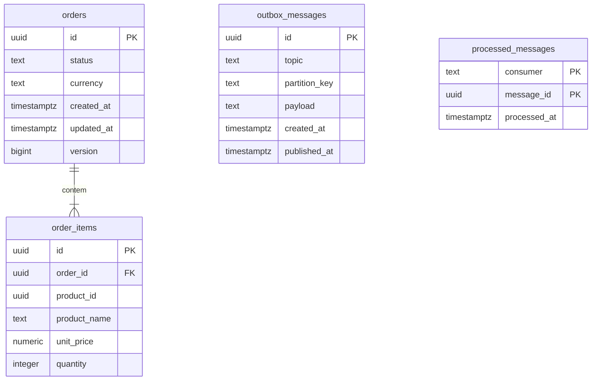

# Diagrama do banco de dados — Pedidos

Estado: **proposta para revisão**, em 27/10/2026. Este diagrama não cria tabelas nem substitui a especificação de persistência da funcionalidade.

## Estado verificado

A base PostgreSQL/JPA/Flyway e o domínio foram implementados. Não foram encontradas migrations de produção ou mapeamentos JPA das tabelas abaixo. A documentação de persistência registra somente a tabela técnica de histórico do Flyway no banco local; não houve nova inspeção do banco nesta tarefa.

As especificações atuais prevalecem sobre o inventário antigo de `architecture.md`, que ainda descreve JPA e domínio como ausentes.

## Modelo relacional proposto

Todos os nomes de tabelas, colunas, tipos e chaves deste diagrama são propostas físicas para futura aprovação.

## Relacionamentos e integridade

- `order_items.order_id` referencia `orders.id`. Cada item pertence a um pedido; cada pedido deve conter pelo menos um item. A FK isoladamente não garante a existência mínima de um item: essa regra exige validação na criação transacional.
- `product_id` identifica um produto externo. Não há FK para o banco de Produtos nem tabelas locais de catálogo ou estoque.
- `product_name` e `unit_price` preservam a cópia histórica do produto.
- A regra aprovada proíbe produtos repetidos no pedido. Propõe-se `UNIQUE (order_id, product_id)` como proteção física adicional.
- Propõem-se `CHECK (quantity > 0)` e `CHECK (unit_price >= 0)`, além de campos obrigatórios não nulos.
- A regra monetária aprovada exige duas casas decimais exatas, sem arredondamento. `numeric` indica decimal exato; precisão máxima e mecanismo SQL de rejeição de excesso de escala ainda precisam ser especificados. Não se presume que a declaração de escala, sozinha, rejeite arredondamentos.
- A moeda única é mantida em `orders.currency`. O domínio atual também recebe moeda em `OrderItem` para validar compatibilidade; omiti-la na tabela de itens é uma proposta para evitar duplicação.
- Total e subtotal são derivados dos itens. A proposta não os armazena como colunas; o total existente no objeto `Order` é calculado durante sua construção.
- O domínio atual possui `AWAITING_STOCK`, `AWAITING_PAYMENT` e `REJECTED`. A representação e a restrição SQL de `status` serão definidas na especificação; cancelamento e pagamento continuam fora desse recorte.
- A PK composta proposta de `processed_messages` garante unicidade por `(consumer, message_id)`. O mesmo identificador pode ser processado por consumidores diferentes.
- Outbox e deduplicação aparecem sem FKs para pedidos. Seus modelos propostos na arquitetura não definem essas referências relacionais; não se presume vínculo por campos internos do payload.

## Transações e decisões pendentes

Conforme a arquitetura proposta, a criação deverá persistir pedido, itens e `ReserveStock` na Outbox na mesma transação local. O consumo deverá persistir deduplicação, alteração do pedido e eventual novo comando na mesma transação, confirmando o offset depois da persistência. Esses comportamentos ainda dependem de suas especificações.

`outbox_messages.payload` deverá conter o envelope serializado, sem tabela separada para `MessageEnvelope`. `published_at` nulo é uma proposta para identificar mensagens pendentes. Tipagem do payload, polling, índices e retenção serão especificados nas funcionalidades correspondentes.

O domínio atual não contém identificador próprio do item, timestamps ou versão otimista. `order_items.id`, `created_at`, `updated_at` e `version` representam a evolução de persistência proposta na arquitetura; geração, reidratação e concorrência dependem de especificação. Também permanecem pendentes as políticas de exclusão/cascata e preservação da ordem dos itens.

Produtos, Estoque e a infraestrutura Kafka ainda não estão disponíveis conforme o contexto informado. Kafka é infraestrutura externa, sem tabela neste modelo. Este desenho não depende de sua implantação para ser revisado.

## Fontes e validação

- [Especificação da base de persistência](../../specs/base-persistencia-integracao/spec.md).
- [Especificação do domínio](../../specs/dominio-pedidos/spec.md).
- [Persistência local e evidências anteriores](../persistence.md).
- [Estado atual do projeto](../project-status.md).
- [Arquitetura proposta](../../architecture.md).
- [Order](../../src/main/java/com/dias/orders_service/domain/entity/Order.java), [OrderItem](../../src/main/java/com/dias/orders_service/domain/entity/OrderItem.java) e [OrderStatus](../../src/main/java/com/dias/orders_service/domain/enums/OrderStatus.java).

Validação desta tarefa: leitura das especificações, código e documentação e inventário das migrations. Não foram executados SQL, migrations, testes ou renderização Mermaid.
